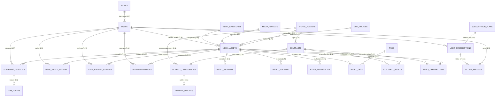

# MediaMerge - Normalized Entity-Relationship (ER) Architecture
### Target RDBMS: MySQL 8.0 (3NF Relational Model)

---

### Entity-Relationship (ER) Summary Listing

#### 1. One-to-Many Relationships (1:N)
1. **`roles` -> `users`**: A role (Admin, Producer, Content Manager, etc.) is assigned to multiple user accounts.
2. **`media_categories` -> `media_assets`**: A media category (e.g. Feature Film, Web Series, Documentary) classifies multiple media assets.
3. **`media_formats` -> `media_assets`**: An encoding profile (e.g. 4K UHD ProRes, 1080p FHD H.264) defines the technical profile of multiple assets.
4. **`drm_policies` -> `media_assets`**: A digital rights policy (e.g. Widevine L1, FairPlay) governs multiple media assets.
5. **`rights_holders` -> `media_assets`**: A studio or content creator holds intellectual property rights for multiple assets.
6. **`rights_holders` -> `contracts`**: A rights holder executes multiple legal licensing contracts over time.
7. **`media_assets` -> `asset_metadata`**: A single media asset has multiple technical key-value parameters (aspect ratio, audio channels, color space).
8. **`media_assets` -> `asset_versions`**: A single media asset tracks multiple file revisions and checksums (v1.0.0, v1.1.0, etc.).
9. **`media_assets` -> `asset_permissions`**: Granular permissions (view, edit, download) granted across multiple users or roles for an asset.
10. **`contracts` -> `sales_transactions`**: A contract aggregates multiple daily streaming or syndication sales transactions.
11. **`contracts` -> `royalty_calculations`**: A contract undergoes recurring periodic royalty settlements (quarterly/monthly).
12. **`royalty_calculations` -> `royalty_payouts`**: A calculated royalty statement has corresponding banking payouts (NEFT/RTGS).
13. **`subscription_plans` -> `user_subscriptions`**: A plan tier (Standard HD, Premium 4K) is subscribed to by many users.
14. **`user_subscriptions` -> `billing_invoices`**: An ongoing subscription generates recurring monthly/annual billing invoices.
15. **`streaming_sessions` -> `drm_tokens`**: A user streaming session issues one or more cryptographic playback tokens.
16. **`users` -> `user_watch_history`**: A user tracks playback resume timestamps across multiple viewed assets.
17. **`users` -> `user_ratings_reviews`**: A user posts 1-5 star ratings and reviews for different assets.
18. **`users` -> `recommendations`**: A user receives personalized algorithmic recommendation scores.

#### 2. Many-to-Many Relationships (M:N)
1. **`media_assets` <-> `tags` (via `asset_tags`)**: An asset has multiple searchable tags, and a tag applies to many assets.
2. **`contracts` <-> `media_assets` (via `contract_assets`)**: A licensing contract covers multiple catalog assets, and non-exclusive assets may be licensed across multiple partner contracts.
